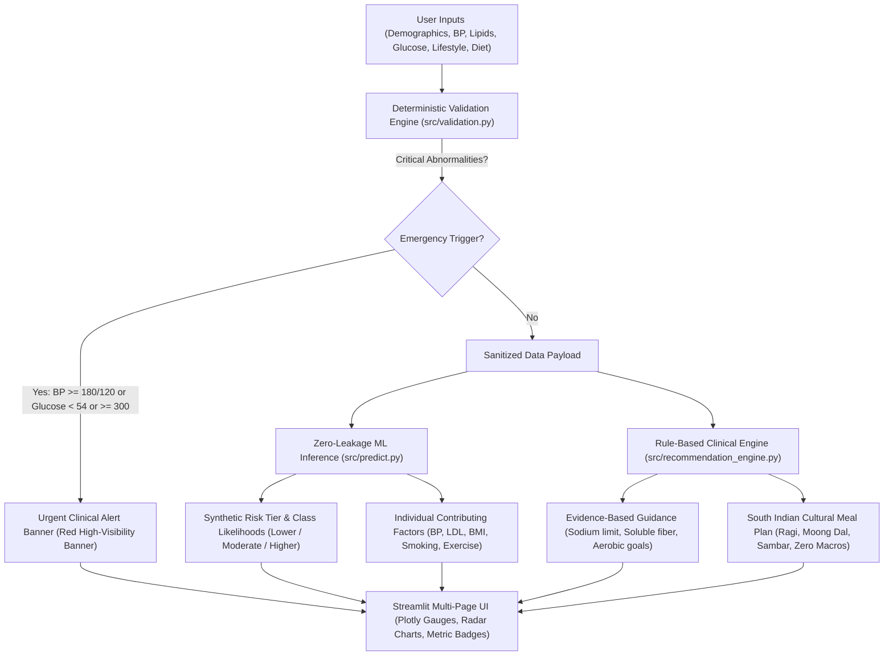
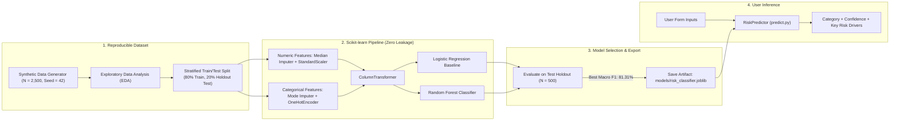
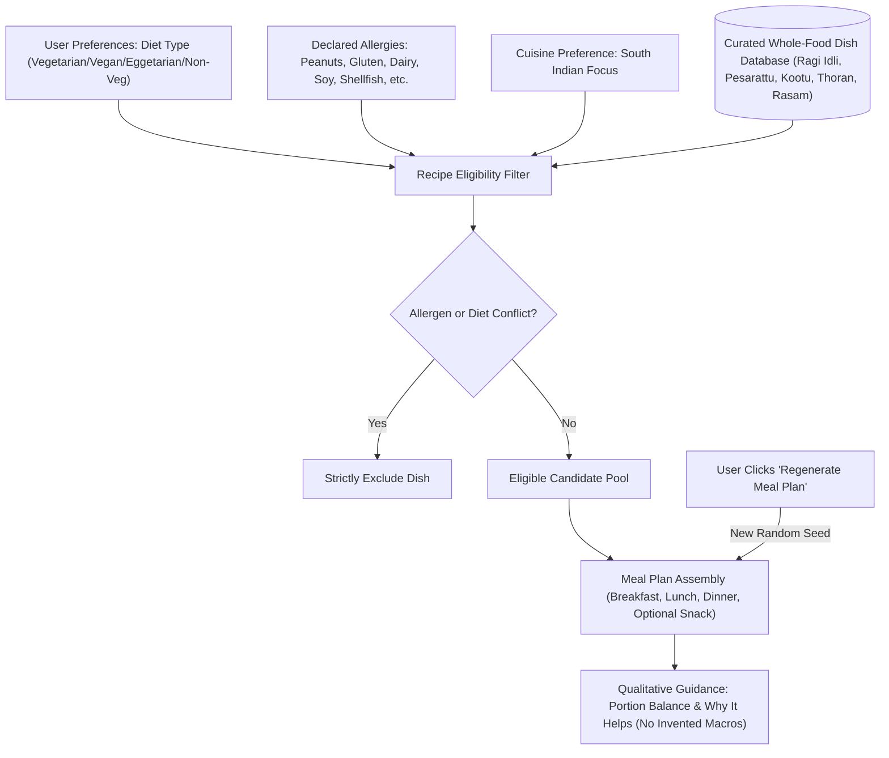

# HealthRisk AI: Executive Abstract & Architecture Report

An educational cardiometabolic health analytics prototype and cultural nutrition decision-support system.

---

## 1. Executive Summary

**HealthRisk AI** is an interactive web-based prototype designed to bridge the gap between clinical data collection, machine learning risk estimation, and actionable daily lifestyle habits.

The application allows users to input standard biometric measurements (such as blood pressure, body mass index, cholesterol panels, blood glucose, and daily habits). Instead of acting as an opaque black box, HealthRisk AI:
1. **Validates** every input against biologically realistic thresholds to catch typographical errors and acute clinical emergencies.
2. **Evaluates** a zero-leakage machine learning classifier trained on multi-factorial cardiometabolic patterns.
3. **Explains** the top contributing risk and protective factors in plain, accessible language.
4. **Formulates** evidence-based lifestyle suggestions and a customized daily South Indian meal plan that strictly adheres to dietary preferences and food allergies.

> **Important Clinical Scope:** HealthRisk AI is strictly an **educational prototype**. It does NOT provide medical diagnoses or disease probabilities. All outputs are intended for learning, lifestyle awareness, and structured discussions with qualified healthcare professionals.

---

## 2. High-Level System Architecture

The following diagram illustrates how user data moves through validation, machine learning inference, clinical rule synthesis, and presentation:



---

## 3. Machine Learning Pipeline Architecture

The machine learning workflow ensures complete separation between training and test sets to prevent data leakage. Preprocessing transformations are fit exclusively on training data and stored in the joblib pipeline.



---

## 4. Cultural Meal Planning & Recommendation Workflow

The meal recommendation engine uses deterministic nutritional rules derived from WHO, ADA, and ICMR-NIN guidelines. It features a South Indian culinary focus while respecting dietary patterns and food allergies.



---

## 5. Actual Machine Learning Evaluation Metrics

Both models were evaluated on the **independent 20% test holdout ($N = 500$ samples)** from the reproducible synthetic dataset:

| Metric | Logistic Regression Baseline | Random Forest Classifier | Selection Decision |
| :--- | :---: | :---: | :---: |
| **Test Accuracy** | **81.60%** | 77.20% | **Logistic Regression Selected** |
| **F1 Score (Macro)** | **0.8131** | 0.7082 | *Superior balance across all risk classes* |
| **F1 Score (Weighted)** | **0.8155** | 0.7645 | |
| **Precision (Macro)** | **83.17%** | 85.25% | |
| **Recall (Macro)** | **79.92%** | 66.37% | |

### Confusion Matrix (Test Set, $N = 500$):
- **Lower Synthetic Risk:** 155 correctly identified, 48 classified as Moderate, 0 classified as Higher.
- **Moderate Synthetic Risk:** 27 classified as Lower, 217 correctly identified, 6 classified as Higher.
- **Higher Synthetic Risk:** 0 classified as Lower, 11 classified as Moderate, 36 correctly identified.

### Top Predictive Biometric Factors:
1. **Diastolic Blood Pressure** (Arterial baseline pressure)
2. **Systolic Blood Pressure** (Peak arterial pressure)
3. **Body Mass Index (BMI)** (Adiposity indicator)
4. **Fasting Blood Glucose** (Glycemic regulation)
5. **Age** (Biological vascular aging)
6. **Waist Circumference** (Central abdominal adiposity)
7. **Total & LDL Cholesterol** (Atherogenic lipid burden)

---

## 6. Structure of the Application Pages

1. **Home (`pages/1_Home.py`):**
   - Striking gradient hero and prototype overview.
   - Quick one-click demo profile buttons (Moderate Risk / Higher Risk).
   - Overview cards of all supported health measurements.
2. **Health Assessment (`pages/2_Health_Assessment.py`):**
   - Biometric inputs with live BMI auto-calculation and pediatric cutoff advisory.
   - Separate glucose inputs (Fasting, Postprandial, Random, HbA1c) with timing context.
   - Lifestyle and dietary preference selectors (Allergies, Indian regional cuisine, Daily INR budget).
3. **Prediction Results (`pages/3_Prediction_Results.py`):**
   - Emergency banner triggered for crisis-level readings.
   - Plotly interactive gauge (Synthetic Risk Index) and multi-pillar radar profile chart.
   - Metric cards with semantic badges: **Normal**, **Abnormal**, and **Missing / Unassessed** (dashed grey styling, never falsely assumed healthy).
   - Individual contributing-factor explanations and evidence-based guidance.
4. **Diet Planner (`pages/4_Diet_Planner.py`):**
   - Culturally tailored South Indian meal schedule (Breakfast, Lunch, Dinner, Snack).
   - Qualitative portion guidance and physiological explanation of ingredients.
   - One-click **"Regenerate Meal Plan"** button.
   - Budget-conscious grocery tips for local Indian markets (millets, native gourds, dals).
5. **Model Information (`pages/5_Model_Information.py`):**
   - Full model card: synthetic data generation rubric, EDA summary, and pipeline design.
   - Actual test set metrics and interactive Plotly confusion matrix heatmap.
   - Documented clinical limitations and ethical AI boundaries.
6. **About and Disclaimer (`pages/6_About_and_Disclaimer.py`):**
   - Prominent non-diagnostic medical disclaimer.
   - Peer-reviewed clinical citations (WHO 2004, ACC/AHA 2017, NCEP ATP III, ADA 2024, ICMR-NIN).

---

## 7. How to Run Locally

### 1. Activate Environment & Run Tests
```powershell
.\.venv\Scripts\Activate.ps1
pytest -v
```
*(All 19 automated unit tests pass in ~5 seconds).*

### 2. Launch the Application
```powershell
streamlit run app.py
```
Open **`http://localhost:8501`** in any web browser.

---

## 8. Summary Checklist of Key Requirements

| Requirement | Implementation Details | Status |
| :--- | :--- | :---: |
| **No Paid APIs or DBs** | Fully self-contained local Python, Scikit-learn, and Plotly runtime | Verified |
| **Streamlit Cloud Ready** | All paths resolve relative to project root; zero hardcoded paths | Verified |
| **Bold Visual Design** | Custom dark theme (`#0A0E17`), glassmorphism cards, Google Fonts | Verified |
| **Safe Recommendations** | Strictly limits sodium, excludes declared allergens, avoids high-potassium pushing | Verified |
| **Qualitative Nutrition** | No invented macros or calorie figures; qualitative portion guidance | Verified |
| **Zero Data Leakage** | Preprocessing fit strictly on training data; median imputation at prediction time | Verified |
| **Clean Attribution** | Clean interface without extraneous personal footers | Verified |
